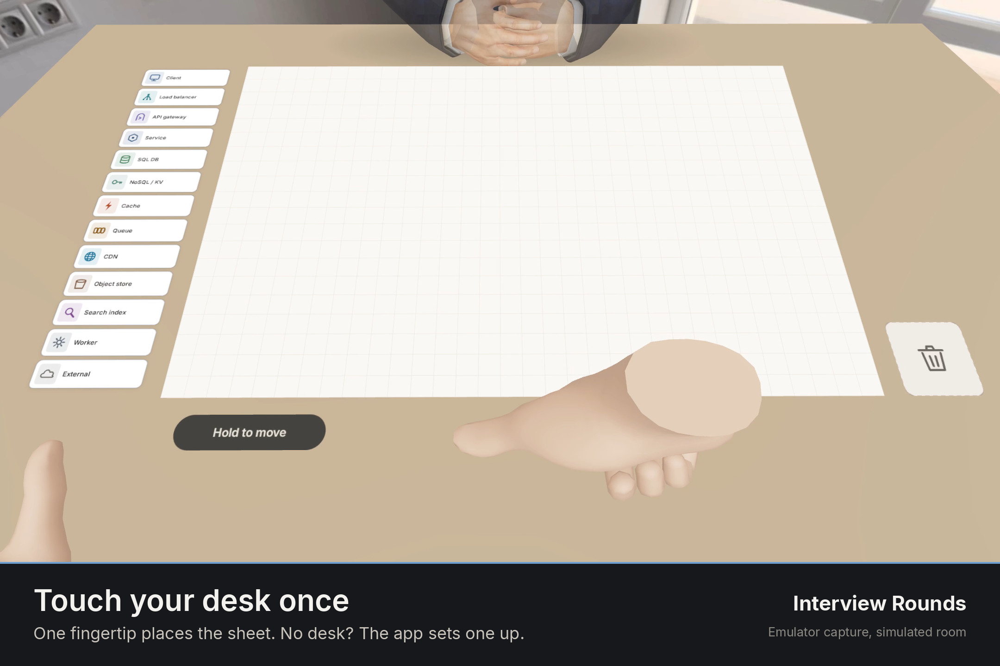
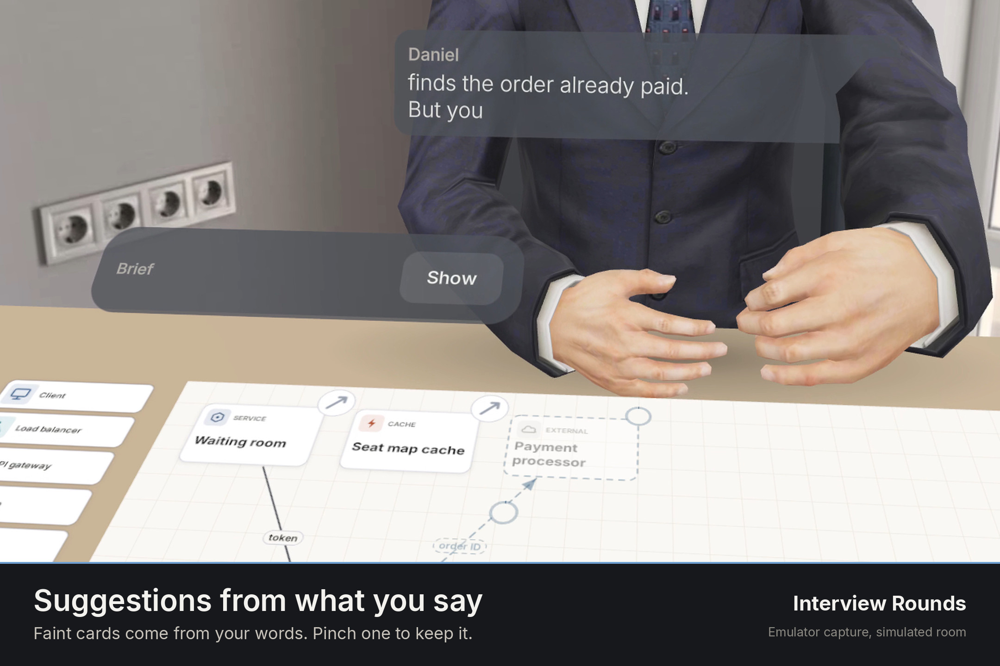
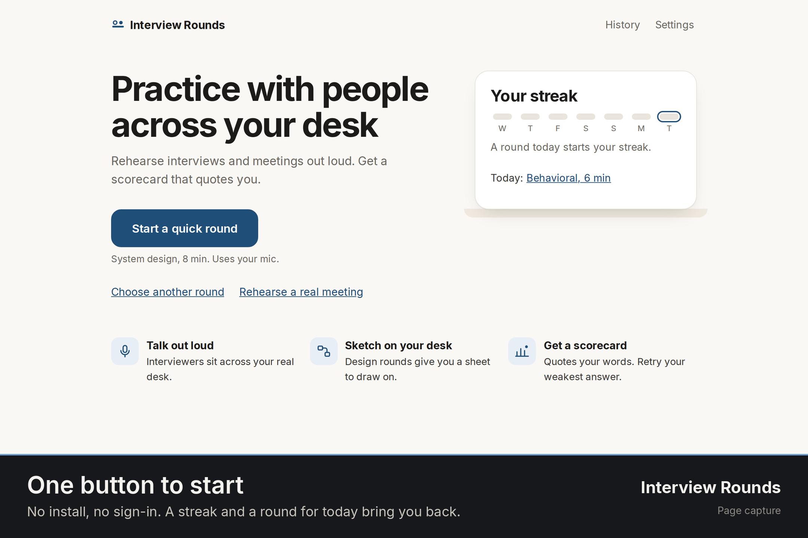
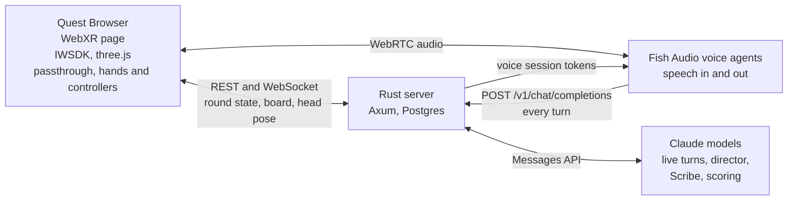
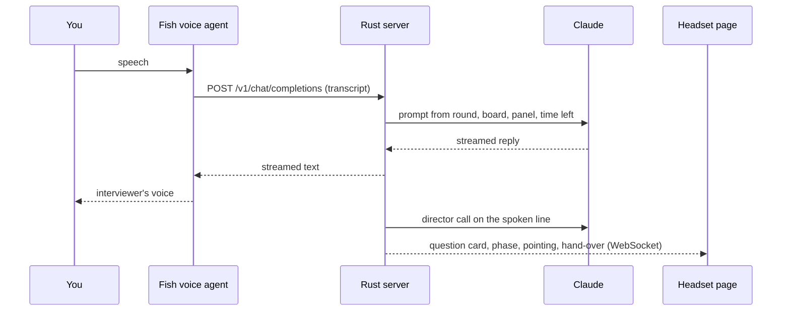

# Interview Rounds

Spoken practice for job interviews and meetings, seated, in mixed reality on Meta Quest.

[Open the app](https://rounds.dijmo.com) | [Watch the demo](<VIDEO_URL>) | [Architecture](#architecture) | [Run it locally](#develop)

[](<VIDEO_URL>)

Interview Rounds is a seated, hands-first practice room for job interviews and real meetings. In passthrough, an interviewer sits across your real desk, meets your eyes and asks a question by voice. You answer out loud, and they follow up on what you said. Passthrough is there for a reason: your own desk is the whiteboard. Touch it once, then pinch and draw with bare hands, and the interviewer reads your board and points at it. The round ends with a scorecard that quotes your own words, and a 2 minute retry of your weakest answer, scored before and after.

Reading sample answers on a screen does not put a person across the table. A headset with passthrough does.

| | |
|---|---|
| Runs on | Quest 3 and 3S, in the Quest Browser. No install, no sign-in. A 2D preview runs on a computer or phone. |
| Rounds | Software engineer, product manager, and meeting rehearsal. Quick rounds take 6 to 8 minutes. |
| Input | Hands first. Controllers do the same things. |
| Stack | WebXR on Meta's Immersive Web SDK and three.js, a Rust server, Fish Audio voice agents, Claude models |
| Tests | 393 Rust tests and 1,037 web tests |
| License | MIT |

Made by Mohammad Ibrahim for the Meta VR Start Developer Competition 2026, Productivity track.

## Try a round

1. Use a Quest 3 or 3S and the Quest Browser. Sit at a desk or table. A quiet room helps: the interviewer hears everything the microphone hears.
2. Open [rounds.dijmo.com](https://rounds.dijmo.com) and tap **Start a quick round** (system design, 8 minutes).
3. Allow the microphone when the browser asks, then tap **Enter the room**.
4. Touch your desk with one finger where the sheet should go and hold still for a moment. With a controller, rest its tip on the desk and pull the trigger. No desk? After 12 seconds the app sets one up.
5. First round only: a looping hand shows "Pinch and draw a box". Draw one, or press **Skip**. After that, three one-line tips appear once each: name a card by voice, pinch a faint card to keep it, draw a line to link two cards.
6. The interviewer greets you and asks the question. Answer out loud, and draw on the sheet as you would on paper. Say "call that the booking service" to name the card you just drew.
7. Hold **End** on the round bar when you are done, or let the clock run out. The scorecard appears in the headset.

Other rounds and the meeting rehearsal are on the home page (**Choose another round**, **Rehearse a real meeting**). On a computer or phone the same link runs a 2D preview round with the same interviewer and voice.

Each headset can run 3 quick rounds and one full round a day; a retry counts as a quick round.

## Your first minute


- **One button.** The home page has one main button, **Start a quick round**. It asks for the microphone on the page, so the headset view does not stop for a prompt.
- **Two taps to the room.** Allow the microphone, then **Enter the room**. A thin progress bar names each step (Setting up your round, Building the room, Bringing in Daniel, Almost ready). The interviewer's opening line is written while you walk in.
- **One touch to place.** A ring follows your fingertip. Rest it on the desk and the sheet lands there. With no desk, the app sets one up after 12 seconds and says "No desk? We set one up. Hold the bar to move it."
- **Learn by doing.** On the first round a looping hand shows the one gesture, "Pinch and draw a box". Your first box starts the round, and **Skip** is always there. After that, three one-line tips appear once each: name a card by voice, pinch a faint card to keep it, draw a line to link two cards.
- **A live question in about a minute** from opening the link, and a scorecard within ten minutes from a quick round.

## A round, step by step

You pick a round, put on the headset and sit at your desk. Passthrough keeps your real room in view.

| Track | Rounds |
|---|---|
| Software engineer | System design, coding, object design, behavioral |
| Product manager | Product sense, metrics and execution, leadership |
| Meeting rehearsal | Investor pitch, client proposal, exec status update, salary negotiation, performance review, project kickoff, or a meeting you describe |

Quick rounds take 6 to 8 minutes with one interviewer. Full rounds take 20 to 30 minutes, and some bring in a second interviewer. There are eight interviewers and attendees, each with their own voice.

### 1. Touch your desk



Room images are emulator captures in a simulated room. Report images are page captures.

You touch the desk once and the sheet lands there. The interviewer sits down across from you, looks at you and greets you by voice with the problem. The interviewers are life-size, seated people in your real room. They meet your eyes and follow your head, breathe, blink and nod, and speak with lip sync from their voice. While they think, they show it. Captions name who is speaking.

### 2. Pinch and draw


In board rounds the sheet is your whiteboard:

- Pinch and draw, or pull a controller's trigger. A rough box becomes a card, a line from one card to another becomes a connection, a circle becomes a client. Anything else stays as ink.
- Say "call that the booking service" to name the card you just drew or touched. A drawn box named "seat table" becomes a database card.
- A tray of cards sits beside the sheet. Coding has a code panel, product rounds use sticky notes, object design uses class cards.

### 3. The interviewer reads your board


You answer out loud. The interviewer follows up on what you said, moves the round through its phases and keeps time. The interviewer reads the board, asks about what is on it, and can point at a card.

### 4. Suggestions from what you say



While you talk, a Scribe suggests board changes as faint cards. Pinch one to keep it. Untouched, it settles after 4 seconds.

### 5. Or rehearse a meeting


For a meeting rehearsal you pick a template (its attendees come filled in) or describe your own meeting: who is in the room, what they care about and what you want. The app prepares the room. Two or three people sit across the table and turn to whoever is speaking. Each attendee has their own stance and concerns. They question you on what you say and pass the floor between them.

The demo video is emulator footage in simulated rooms. It starts with a feature tour narrated by a synthetic voice, then shows part of a system design round and a meeting rehearsal, where the candidate is a synthetic voice reading a script (labeled on screen).

## The scorecard


When the round ends, cards in the headset show the verdict, four competency bars, your top strength and the thing to fix, with **Retry this answer** and **See full report**. The full report is a normal web page:


- a verdict on the hire / no-hire scale with a confidence (meetings show the outcome instead), set by a fixed rule over the scores, not by a model;
- four competencies scored 1 to 4 against your level, with "vs last time" arrows from your second round of the same kind;
- what went well and what to work on, each with your own words and the time you said them;
- your weakest moment, what a strong answer covers, and a 2 minute retry that is scored again, before and after;
- what to practice next;
- how you sounded: pace, filler words, long pauses, how much you talked, and how much you faced whoever was speaking (from head direction);
- the transcript and the final board, and an optional public link to share the scorecard.

A round too short to judge says so instead of guessing.

## Why you would do a second round



History, a streak, a skill chart and a suggested round for today are kept per headset, with no account. The retry and the "vs last time" arrows turn each report into the next practice.

## What the agents do

- **The interviewer** hears your answer and follows up on your own words. It reads a text view of your board on every turn, asks about what is on it, and can point at a card.
- **A director** turns each spoken line into actions: show the question card, move to the next phase, point at a card, hand the floor to another person, end the round.
- **A Scribe** turns what you say into faint suggested cards. Pinch one to keep it.
- **In a meeting** each attendee has a hidden stance that is updated as you answer. Address someone by name and they take the floor.
- **The verdict** is set by a fixed rule over the scores, not by a model.

Every spoken turn goes through the server, which rebuilds the prompt from the round, the persona, the phase, the time left, a text view of your board and the shared transcript.

## Hands, controllers and comfort

| What you do | With hands | With a controller |
|---|---|---|
| Place the sheet | Rest a fingertip on the desk for a moment | Rest the controller's tip on the desk, then pull the trigger |
| Draw a card, a connection or ink | Pinch and draw on the sheet | Hold the trigger with the tip on the sheet, or aim the ray with its cursor dot |
| Move a card | Pinch it and drag | Trigger on it and drag |
| Keep a suggestion | Pinch it | Trigger on it |
| Name a card | Draw or touch it, then say "call that ..." | The same |
| Delete | Drag it to the bin | The same |
| Undo the last change | Drag the mistake to the bin | A or X |
| Press a button | Poke it, or pinch with the hand's ray | Trigger with the ray |
| Move the sheet | Pinch its "Hold to move" bar | Trigger on the bar |
| Pause, captions, mute, end | Poke the round bar (End needs a one second hold) | The same with the ray |

Hands come first. Controllers do the same things. Both share one input path. You can pick up or put down a controller mid round. The cards switch their wording. On controllers the thumbstick scrolls the code panel and short haptic pulses mark presses and snaps. With hands, every pinch, snap and drop has a visual change and a quiet sound.

- **Seated** at your own desk, everything within reach at desk height. No standing, no walking, no typing in the room.
- **Passthrough** keeps your room, your notes and your coffee in view the whole time.
- **One hand is enough.** The card tray sits on your other hand's side: Main hand in Settings, or the hand that touched the desk.
- **Captions** (CC on the round bar, or in Settings) show who is speaking and what they said.
- **Your pace.** Pause from the round bar, the system menu or by taking the headset off, and the interviewer waits.
- **Readable panels:** dark glass with large type over a bright room, and calm 2D pages with large targets.
- **Settings:** role, level (junior to staff), interviewer style (warm, neutral or tough), captions, sound effects, main hand, and Delete my data.

<details>
<summary><b>Hand input in numbers</b></summary>

- **Placing:** a fingertip that rests nearly still (under 2 cm a second) for 0.6 s, 25 to 75 cm below the eyes, places the sheet. A hand in the lap does not count. A controller must point down and rest for 0.3 s before the trigger places. With no touch in 12 s, a desk is set up at a seated height.
- **Pinch:** from the system's select event. The pinch point is smoothed with a One Euro filter. For the first 0.1 s the slide of the closing fingers (up to 2.5 cm) is held so a tap stays a tap, and the last 80 ms of a release is trimmed. A pinch that drops for under 150 ms within 6 cm of the hand carries on as one stroke or drag.
- **Strokes:** under 1.5 cm a stroke makes no mark. A connection may start up to 1.4 cm outside a card (a 2.2 cm band with the card's rim), end 1.5 cm outside its target, and snaps to a card within 4 cm.
- **Targets:** card tabs 2 cm, edge chips and edge labels 2.2 cm. Ink is picked up only after a still 0.3 s pinch.
- **Suggestions:** a pinch keeps one. A one second hold or a drag to the bin dismisses it. Untouched, it settles after 4 s.
- **Tracking loss:** a hand that leaves tracking keeps its gesture for 0.3 s, then lets go. A pinch starts only within 12 cm above the sheet, and a hand highlights what is under it within 4 cm.
- **Checked by** unit tests that replay noisy hands through the board: jitter, tremor, uneven and missing frames, pinch drops and tracking dropouts.

</details>

## Architecture



- **The page** (`web/`) has the 2D pages (Preact) and the room, built with Meta's Immersive Web SDK (IWSDK) on three.js. The session is WebXR `immersive-ar` with passthrough. Hand tracking, hit testing and anchors are asked for but none is required. The desk is placed by touch, and the room is anchored there when the headset grants anchors. People are Microsoft Rocketbox avatars converted to compressed glTF, with seated animation, gaze that meets your head, blinks, nods and lip sync from the voice.
- **The voice** runs on Fish Audio Agents through their web client: speech recognition, turn taking, barge-in and the voices, one voice per person. On every turn Fish calls the server's model endpoint (`POST /v1/chat/completions`, OpenAI format, streamed).
- **The server** (`server/`) is Rust with Axum, Tokio and sqlx on Postgres. It owns the conversation. Each turn it rebuilds the prompt from the session (persona, round script, phase, time left, a text summary of the board, the panel's shared transcript, hidden meeting state), streams the model's reply back to the voice, and pushes round state, board changes and gestures to the page over a WebSocket with sequence numbers, acks and replay. It also serves the built web app, the reports and the public scorecard pages from one origin.
- **The content** (`content/`) is data: rounds, personas, meeting templates, rubrics, question banks and prompts, checked against JSON Schemas.
- **The contract** between page and server is `docs/protocol.md`.

### One spoken turn



### Models by role

Defaults are in `server/src/config.rs` and `server/src/scoring/mod.rs`.

| Role | What it does | Model |
|---|---|---|
| Live turns | The spoken reply, streamed to the voice | Claude Sonnet 5.5, low effort, no thinking; Claude Haiku 5.5 when overloaded |
| Director | Turns each spoken line into actions | Claude Sonnet 5.5 |
| Scribe | Turns what you say into board suggestions | Claude Sonnet 5.5 |
| Meeting state | Updates each attendee's hidden stance and concerns | Claude Sonnet 5.5 |
| Meeting prepare | Fills in likely objections and concerns for your meeting | Claude Opus 5.5 |
| Headset card, retry score | The short card after the round; the 2 minute retry | Claude Sonnet 5.5 |
| Report | Evidence, scores, strengths, fixes, model answer (structured output) | Claude Opus 5.5, medium effort; Sonnet 5.5 as fallback |
| Verdict | Hire / no-hire from the scores | A fixed rule, no model |
| Delivery | Pace, fillers, pauses, talk share, facing the speaker | Our code, no model |

## When something breaks

| Situation | What happens |
|---|---|
| Pause, system menu, headset off | The interviewer and the clock stop. A "Welcome back" card waits for Resume. A round can be paused for up to 10 minutes in total. |
| Dropped connection | The page reconnects by itself, the server replays the messages that were missed, and the round carries on. Progress is saved on the server. A lost voice comes back on Resume. |
| Model overload | A turn retries on a second model within its deadline. If both fail, the round holds and the card says "Your interviewer is reconnecting...", then the round carries on. |
| No desk | After 12 seconds the app sets up a desk at a seated height. The sheet's "Hold to move" bar moves it. |
| Hands lost | A hand that leaves tracking keeps its gesture for 0.3 s, then lets go cleanly. A short pinch drop mid stroke carries on. |
| Switching input | Pick up a controller and the cards switch to controller wording. Put it down and hands take over. |
| Slow network | The room's people are fetched while you read the start page and cached by version. The progress bar shows each step, so the wait is short and not silent. |
| Phone preview | On a narrow screen the 2D preview adds an **End** button on the page, with **End round** and **Keep going** to confirm. |
| Microphone blocked | The round page says how to allow it, in the browser and in the Quest's settings, with a **Check again** button. |
| Report trouble | A report that fails is scored again. A round too short to judge says so. A slow report goes to History. |
| Daily limit | Each headset can run 3 quick rounds and one full round a day; a retry counts as a quick round. This keeps the hosted app open for everyone. |

## Measurements

<details>
<summary><b>Frame rate, loading and reply times</b></summary>

- **Frame rate:** the session asks for 72 Hz and raises to 90 Hz only when frames show headroom. Fixed foveation is on. The room is built to a budget of about 60 draw calls, 60,000 triangles and 64 MB of textures, with KTX2 textures and no post-processing.
- **Measured in the emulator (both eyes, Nov 14):** one interviewer with the sheet and the panels, at most 60 draw calls and about 35,000 triangles. Three people in a meeting room with the sheet and the wall board, 58 draw calls, 53,636 triangles and about 35 MB of textures. Avatars are slimmed at load: morphs that never move are dropped and the legs under the desk are removed.
- **Room ready:** about 1.5 to 3 s from the tap to a room ready to enter, measured against the hosted app in a headless browser. A real voice session adds about half a second.
- **Greeting:** the interviewer's opening line is written while you enter the room. In a headless run against the hosted app its first words were ready 0.16 s after **Enter** (test voice; the real voice adds its own start-up).
- **Reply time:** in the round filmed for the demo, with the real voice agent, the interviewer started speaking 2.6 to 3.9 s after the candidate stopped. The voice service decides your turn is over, the server streams the model's first words, and speech starts as they arrive. The interviewer shows a thinking look while you wait.
- **Scorecard:** scoring starts while the goodbye plays. The short card comes first in the headset, and the full report follows in under a minute.
- **How the frame numbers were taken:** `web/e2e/perf-room.mjs` and `web/e2e/perf-meeting.mjs` read the renderer's counters in the emulator.

</details>

## Tests

393 Rust tests and 1,037 web tests run on the released build.

- **Server:** Rust unit and integration tests, the database tests on Postgres (`cd server && cargo test`).
- **Web:** Vitest unit tests for the board rules, the input filters, the round controller, the room UI and the pages (`cd web && npm test`), including replays of noisy hand input through the whole board path.
- **Shared fixtures:** the board rules run the same fixtures in TypeScript and Rust (`content/fixtures/`).
- **Emulator runs:** `web/e2e/` drives whole rounds in Meta's IWER emulator against a running server: every round type, hands and controllers, onboarding, pause and resume, switching input, two rounds in a row, and a meeting.
- **Smoke:** `tools/smoke/round.mjs` runs one round end to end with the fake voice and real model calls.
- **Copy and content checks:** `tools/check-copy.mjs` (dash rules for user-facing text) and `tools/content-check.mjs` (content against its schemas).

## Develop

### Requirements

You need Rust 1.94 or newer, Node 20.19+, 22.12+ or 24+, and Postgres (production runs 18). The interviewer, the Scribe and scoring call the Anthropic API, so you need an Anthropic API key even without the real voice. The real voice also needs a Fish Audio account and a public HTTPS address for the server, because Fish calls the server's model endpoint on every turn.

The server will not start unless the three FISH_ variables are set. Without a Fish Audio account, set placeholder values and use the fake voice.

### Quick start

```sh
git clone https://github.com/Inventor227/interviewrounds.git
cd interviewrounds
```

Server:

```sh
createdb interview_rounds
cd server
set -a; . ../.env.local; set +a        # your own file
CONTENT_DIR=../content cargo run       # migrations run at start
```

Web:

```sh
cd web
npm ci
npm run dev        # https://localhost:8081, with a self-signed certificate
```

The dev server proxies `/api`, `/ws`, `/v1`, `/s` and `/healthz` to `IR_API_ORIGIN` (default `http://127.0.0.1:8080`). On localhost the IWSDK dev plugin adds Meta's IWER emulator (Quest 3 in a home office room, set in `web/iwsdk.config.json`), so the room runs in a desktop browser. `?fake=<scenario>` serves fixture data so the 2D pages render without a server.

Deploy: deploy/Dockerfile builds one image with the server and the web app. deploy/compose.yml is the Compose file the hosted app uses.

### Configuration

The server reads its settings from the environment at start (`server/src/config.rs`). Keep them in a local file that git ignores (for example `.env.local`; `.env*` is in `.gitignore`) and do not commit real keys.

| Variable | What |
|---|---|
| `DATABASE_URL` | Postgres connection string |
| `APP_ORIGIN` | The origin the page is served from; sockets from any other origin are refused |
| `ANTHROPIC_API_KEY`, `ANTHROPIC_WORKSPACE_ID` | Anthropic API access |
| `FISH_AUDIO_API_KEY`, `FISH_AGENT_ID`, `FISH_LLM_SECRET` | Fish Audio access, the agent the voices use, and the bearer secret Fish sends to the model endpoint |
| `DEV_KEY` | Unlocks the fake voice and developer routes |

For local work set `APP_ORIGIN=http://127.0.0.1:8080`: the web dev server presents that origin when it proxies.

`tools/fish/setup-agent.mjs` creates or updates the Fish agent, points it at `APP_ORIGIN` as a custom model and prints the agent id for `FISH_AGENT_ID` (`--dry-run` changes nothing).

Usage limits and spend caps: see server/src/config.rs.

<details>
<summary><b>Optional variables</b></summary>

| Variable | Default |
|---|---|
| `PORT` | `8080` |
| `PUBLIC_BASE_URL` | `APP_ORIGIN` (used in public share links) |
| `CONTENT_DIR`, `PUBLIC_DIR`, `DATA_DIR` | `content`, `public`, `data` |
| `LIVE_MODEL`, `FAST_MODEL` | `claude-sonnet-5-5` |
| `LIVE_FALLBACK_MODEL` | `claude-haiku-5-5` |
| `SCORING_MODEL` | `claude-opus-5-5` |
| `LIVE_EFFORT`, `SCORING_EFFORT` | `low`, `medium` |
| `PANEL_MODE` | `swap` (one voice at a time; `joined` connects every panelist at the start) |
| `CSP_CONNECT_EXTRA` | the Fish and LiveKit hosts |
| `LOG_FORMAT`, `RUST_LOG` | plain logs; `json` for JSON |

</details>

### The fake voice

Fish sessions cost money per minute, so development uses a fake voice: typed turns go to the same model endpoint and the reply is spoken with the browser's speech synthesis. The prompts, the round, the board and scoring all run as usual. No Fish session starts.

1. In the dev build, store the server's `DEV_KEY` for the tab from the browser console: `sessionStorage.setItem('ir_dev_key', '<your DEV_KEY>')`.
2. Open a round with `?preview=1`, for example `/round/sde.system_design.short?preview=1`. The 2D preview shows a box where you type your answers.

The server allows the fake voice only with the `X-Dev-Key` header, so the hosted app always uses the real voice.

### Commands

| Command | What |
|---|---|
| `cd web && npm test` / `npm run typecheck` | Web unit tests (Vitest) and types |
| `cd server && cargo test` | Server tests; the database tests need `DATABASE_URL` |
| `node tools/check-copy.mjs` | Dash rules for user-facing text |
| `node tools/content-check.mjs` | Content against its schemas, and every reference resolves |
| `DEV_KEY=... node tools/smoke/round.mjs --origin <url>` | One round end to end against a running server with the fake voice (real model calls) |

`web/e2e/` holds scripted emulator runs of whole rounds.

<details>
<summary><b>Repository layout</b></summary>

| Path | What |
|---|---|
| `web/src/app` | 2D pages: home, round start, meeting setup, report, history, settings, device check (`/diag`) |
| `web/src/xr` | The room: placement, avatars, panels, captions, sounds, input from hands and controllers |
| `web/src/board` | The sheet: drawing, shape recognition, cards, connections, Scribe suggestions, kits per round |
| `web/src/session` | The round controller: pause and resume, onboarding, cues, head samples |
| `web/src/voice`, `web/src/net` | Fish and fake voice transports; REST and socket clients |
| `server/src/orchestrator` | Live turns, the director, prompts, the custom model endpoint |
| `server/src/scoring` | Delivery metrics, the verdict rule, the report |
| `server/src/meeting`, `server/src/board`, `server/src/api` | Meeting plans and hidden state, the board, REST routes |
| `server/migrations`, `server/tests` | Database schema and integration tests |
| `content/` | Rounds, personas, meeting templates, rubrics, question banks, prompts, schemas, shared fixtures |
| `docs/protocol.md` | REST and WebSocket contract |
| `deploy/` | Dockerfile (one image with the server and the built web app) and a Compose file |
| `tools/` | Avatar conversion (Blender in Docker), Fish agent setup, smoke round, copy and content checks |

The hosted app runs as one Docker container next to a Postgres database on a single server.

</details>

## Quest features used

| Feature | How it is used |
|---|---|
| Meta Immersive Web SDK (IWSDK) | The room, spatial UI panels, poke and ray pointers and the session run on IWSDK and three.js. |
| Passthrough mixed reality | A WebXR `immersive-ar` session keeps your real room and desk in view. The interviewer sits across your own desk. |
| Hand tracking | Pinch to draw, pick, drag and connect. A fingertip places the sheet and pokes buttons. Asked for, not required. |
| Controllers | Trigger as the pinch, tip drawing, a ray with a cursor dot, A or X to undo, the thumbstick to scroll, haptic pulses. |
| Anchors | The room is anchored at your desk when the headset grants an anchor. |
| Head pose | The interviewers meet your eyes. Your head direction, sampled 5 times a second, becomes "Facing who spoke" in the report. |
| Session visibility and end events | The system menu and taking the headset off pause the round. |
| Frame rate and foveation | 72 Hz, raised to 90 Hz only with headroom. Fixed foveation. |
| Microphone and WebRTC voice | The microphone is asked for once on the 2D page, before the headset view. |
| Compressed assets | KTX2 textures and meshopt geometry. |
| Immersive Web Emulator (IWER) | The scripted round runs and the demo video's room footage were made in it. |
| Permissions | No plane or mesh detection, so the only permission prompt is the microphone. |

## Privacy and data

There is no account. A device cookie ties your rounds, reports, recordings, history and settings to your headset, and **Delete my data** in Settings removes them all. Your speech goes to Fish Audio for recognition and the voices, and the conversation text goes to Anthropic's API for the interviewers and scoring. A scorecard is public only if you make a share link, and you can take the link down. The tracked-hand outline is served from the app's own origin.

## Next

- Refine drawing, placement and round timing from user feedback.
- Meta VR Glasses (gaze plus pinch on the board), and faster hand-overs between people in panels and meetings.
- Optional sign-in so history follows you across devices, more rounds as content, and an interview-date plan.

## License and credits

- **This project:** MIT license, see `LICENSE`. Third-party parts below keep their own licenses.
- **Avatars:** Microsoft Rocketbox avatars and animations, MIT license, converted with `tools/avatars/`. Notice and list of changes: `web/public/avatars/LICENSE.md`.
- **Third-party code served to the browser:** HeadAudio (lip sync, MIT), three.js (MIT), the meshoptimizer decoder (MIT), the Basis Universal transcoder (Apache 2.0, `web/public/vendor/basis/LICENSE`) and the Meta Quest Touch Plus controller models from WebXR Input Profiles (MIT). Full texts: `web/public/THIRD_PARTY_NOTICES.md`.
- **Sounds:** six UI sounds are edited recordings by Kenney (kenney.nl), CC0 1.0. Six round cues were made with ElevenLabs sound generation on a paid plan and edited. Sources, prompts and edits: `web/public/sfx/CREDITS.md`.
- **Font:** Inter, SIL Open Font License 1.1, served from this site for the 2D pages (`web/src/app/fonts/`) and through UIKit's MSDF fonts in the room.
- **Room:** the table, chairs, wall board and sheet are built in code (`web/public/props/CREDITS.md`).
- **Dependencies** from npm and crates.io keep their own licenses (`web/package-lock.json`, `server/Cargo.lock`).
- **Services:** Fish Audio for voice and Anthropic's Claude models for the interviewers and scoring.
