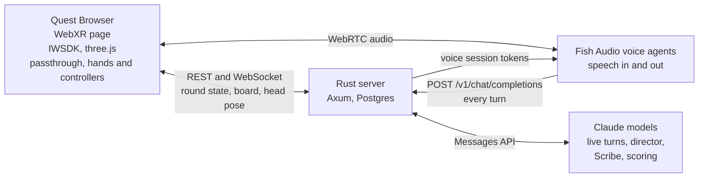

# Interview Rounds

Rehearse job interviews and real meetings out loud, with people sitting across your own desk, on Meta Quest.
After each round you get a scorecard that quotes what you said and tells you what to practise next.

**Try it:** https://rounds.dijmo.com. Open it in the Quest Browser on a Quest 3 or 3S. No sign-in and nothing to
install. On a computer or phone the same link runs a 2D preview of the round with the same interviewer and voice.

**Device testing:** built and tested in Meta's IWSDK emulator (Quest 3 profile) against the hosted server; not yet
checked on a headset.
<!-- DEVICE-CHECK: filled after the Nov 16 Quest test -->

Made by Mohammad Ibrahim for the Meta VR Start Developer Competition 2026 (Productivity track).

## What a round is

You pick a round, put on the headset and sit at your desk. Passthrough keeps your real room. You touch the desk once
and the interviewer sits down across from you, looks at you and greets you by voice. You answer out loud. The
interviewer follows up on what you actually said.

| Track | Rounds |
|---|---|
| Software engineer | System design, coding, object design, behavioral |
| Product manager | Product sense, metrics and execution, leadership |
| Meeting rehearsal | Investor pitch, client proposal, exec status update, salary negotiation, performance review, project kickoff, or a meeting you describe |

Quick rounds take 6 to 8 minutes with one interviewer. Full rounds take 20 to 30 minutes, and some bring in a second
interviewer. For a meeting rehearsal you pick a template (its attendees come filled in) or describe your own meeting:
who is in the room, what they care about and what you want. The attendees then question you on what you say and
pass the floor between them.

**Hands do the work.** In board rounds a sheet lies on your desk:

- Pinch and draw, or pull a controller's trigger. A rough box becomes a card, a line from one card to another becomes
  a connection, a circle becomes a client. Anything else stays as ink.
- Say "call that the booking service" to name the card you just drew or touched.
- A tray of cards sits beside the sheet. Coding has a code panel, product rounds use sticky notes, object design uses
  class cards.
- While you talk, a Scribe suggests board changes as faint cards. Pinch one to keep it; untouched, it settles after
  4 seconds.
- The interviewer reads the board, asks about what is on it, and can point at a card.

Hands and controllers both work, and you can switch at any time. Controllers draw by touching the sheet or from a
distance with a ray and a cursor dot. Buttons take a poke, a pinch on the hand ray or the trigger.

**Pausing.** Use Pause on the round bar, open the system menu, or take the headset off. The interviewer stops, the
clock stops, and when you are back a "Welcome back" card waits for you to resume. A round can be paused for up to
10 minutes in total. If the connection drops, the page reconnects and the round carries on. If the AI models are
overloaded, the round holds and the card says the interviewer is reconnecting.

**The report.** When the round ends, cards in the headset show the verdict, four competency bars, your top strength
and the thing to fix, with **Retry this answer** and **See full report**. The full report is a normal web
page:

- a verdict on the hire / no-hire scale with a confidence (meetings show the outcome instead), set by a fixed rule
  over the scores, not by the model;
- four competencies scored 1 to 4 against your level, with "vs last time" arrows from your second round of the same
  kind;
- what went well and what to work on, each with your own words and the time you said them;
- your weakest moment, what a strong answer covers, and a 2 minute retry that is scored again, before and after;
- what to practise next;
- how you sounded: pace, filler words, long pauses, how much you talked, and how much you faced whoever was speaking
  (from head direction);
- the transcript and the final board, and an optional public link to share the scorecard.

A round too short to judge says so instead of guessing. History, a streak and a skill chart are kept per device.

## How it works



- **The page** (`web/`) has the 2D pages (Preact) and the room, built with Meta's Immersive Web SDK (IWSDK) on
  three.js. The session is WebXR `immersive-ar` with passthrough. Hand tracking, hit testing and anchors are asked for
  but none is required; the room is anchored at the desk when the headset grants anchors. People are Microsoft
  Rocketbox avatars converted to compressed glTF, with seated animation, gaze that meets your head, blinks, nods and
  lip sync from the voice.
- **The voice** runs on Fish Audio Agents through their web client: speech recognition, turn taking, barge-in and the
  voices, one voice per interviewer. On every turn Fish calls our server's model endpoint
  (`POST /v1/chat/completions`, OpenAI format, streamed).
- **The server** (`server/`) is Rust with Axum, Tokio and sqlx on Postgres. It owns the conversation: each turn it
  rebuilds the prompt from the session (persona, round script, phase, time left, a text summary of the board, the
  panel's shared transcript, hidden meeting state), streams the model's reply back to the voice, and pushes round
  state, board changes and gestures to the page over a WebSocket. It also serves the built web app, the reports and
  the public scorecard pages from one origin.
- **The models** (defaults in `server/src/config.rs`): live turns on Claude Sonnet 5.5 at low effort, with Claude
  Haiku 5.5 as the fallback when a model is overloaded. After each spoken line a director call turns it into actions
  (question card, next phase, pointing, hand-over, end). The Scribe turns speech into board suggestions. Claude Opus
  5.5 prepares meeting plans and writes the report with structured output. Delivery numbers (pace, fillers, pauses,
  head direction) are computed in code, not by a model.
- **The content** (`content/`) is data: rounds, personas, meeting templates, rubrics, question banks and prompts,
  checked against JSON Schemas.
- **The contract** between page and server is `docs/protocol.md`.

## Run it locally

You need Rust 1.94 or newer, Node 20.19+, 22.12+ or 24+, and Postgres (production runs 18). The
interviewer, the Scribe and scoring call the Anthropic API, so you need an Anthropic API key even without the real
voice. The real voice also needs a Fish Audio account and a public HTTPS address for the server, because Fish calls
the server's model endpoint on every turn.

### Server

The server reads its settings from the environment at start (`server/src/config.rs`). Keep them in a local file that
git ignores (for example `.env.local`; `.env*` is in `.gitignore`) and never commit real keys.

Required:

| Variable | What |
|---|---|
| `DATABASE_URL` | Postgres connection string |
| `APP_ORIGIN` | The origin the page is served from; sockets from any other origin are refused |
| `ANTHROPIC_API_KEY`, `ANTHROPIC_WORKSPACE_ID` | Anthropic API access |
| `FISH_AUDIO_API_KEY`, `FISH_AGENT_ID`, `FISH_LLM_SECRET` | Fish Audio access, the agent the voices use, and the bearer secret Fish sends to the model endpoint |
| `DEV_KEY` | Unlocks the fake voice and developer routes |

Optional, with defaults:

| Variable | Default |
|---|---|
| `PORT` | `8080` |
| `PUBLIC_BASE_URL` | `APP_ORIGIN` (used in public share links) |
| `CONTENT_DIR`, `PUBLIC_DIR`, `DATA_DIR` | `content`, `public`, `data` |
| `LIVE_MODEL`, `FAST_MODEL` | `claude-sonnet-5-5` |
| `LIVE_FALLBACK_MODEL` | `claude-haiku-5-5` |
| `SCORING_MODEL` | `claude-opus-5-5` |
| `LIVE_EFFORT`, `SCORING_EFFORT` | `low`, `medium` |
| `USAGE_PHASE` | `build` (also `judging`, `after`; sets the guest limits) |
| `JUDGE_CAP_USD`, `MODEL_DAILY_CAP_USD` | `100`, `40` |
| `FISH_BUILD_CAP_USD`, `FISH_BUILD_SPENT_USD`, `FISH_RATE_PER_MIN` | `14`, `0`, `0.07` |
| `PANEL_MODE` | `swap` (one voice at a time; `joined` connects every panelist at the start) |
| `CSP_CONNECT_EXTRA` | the Fish and LiveKit hosts |
| `LOG_FORMAT`, `RUST_LOG` | plain logs; `json` for JSON |

`GOOGLE_CLIENT_ID` and `GOOGLE_CLIENT_SECRET` are read but sign-in is not mounted in this build.

```sh
createdb interview_rounds
cd server
set -a; . ../.env.local; set +a        # your own file
CONTENT_DIR=../content cargo run       # migrations run at start
```

For local work set `APP_ORIGIN=http://127.0.0.1:8080`: the web dev server presents that origin when it proxies.

`tools/fish/setup-agent.mjs` creates or updates the Fish agent, points it at `APP_ORIGIN` as a custom model and prints
the agent id for `FISH_AGENT_ID` (`--dry-run` changes nothing).

### Web

```sh
cd web
npm ci
npm run dev        # https://localhost:8081, with a self-signed certificate
```

The dev server proxies `/api`, `/ws`, `/v1`, `/s` and `/healthz` to `IR_API_ORIGIN` (default
`http://127.0.0.1:8080`). On localhost the IWSDK dev plugin adds Meta's IWER emulator (Quest 3 in a home office room,
set in `web/iwsdk.config.json`), so the room runs in a desktop browser. `?fake=<scenario>` serves fixture data so the
2D pages render without a server.

### The fake voice

Fish sessions cost money per minute, so development uses a fake voice: typed turns go to the same model endpoint and
the reply is spoken with the browser's speech synthesis. The prompts, the round, the board and scoring all run as
usual; no Fish session starts.

1. In the dev build, store the server's `DEV_KEY` for the tab from the browser console:
   `sessionStorage.setItem('ir_dev_key', '<your DEV_KEY>')`.
2. Open a round with `?preview=1`, for example `/round/sde.system_design.short?preview=1`. The 2D preview shows a
   box where you type your answers.

The server allows the fake voice only with the `X-Dev-Key` header, so the hosted app always uses the real voice.

### Tests and checks

| Command | What |
|---|---|
| `cd web && npm test` / `npm run typecheck` | Web unit tests (Vitest) and types |
| `cd server && cargo test` | Server tests; the database tests need `DATABASE_URL` |
| `node tools/check-copy.mjs` | No em or en dashes in user-facing text |
| `node tools/content-check.mjs` | Content against its schemas, and every reference resolves |
| `DEV_KEY=... node tools/smoke/round.mjs --origin <url>` | One round end to end against a running server with the fake voice (real model calls) |

`web/e2e/` holds scripted emulator runs of whole rounds.

## Repository layout

| Path | What |
|---|---|
| `web/src/app` | 2D pages: home, round start, meeting setup, report, history, settings, device check (`/diag`) |
| `web/src/xr` | The room: placement, avatars, panels, captions, sounds, input from hands and controllers |
| `web/src/board` | The sheet: drawing, shape recognition, cards, connections, Scribe suggestions, kits per round |
| `web/src/session` | The round controller: pause and resume, onboarding, cues, head samples |
| `web/src/voice`, `web/src/net` | Fish and fake voice transports; REST and socket clients |
| `server/src/orchestrator` | Live turns, the director, prompts, the custom model endpoint |
| `server/src/scoring` | Delivery metrics, the verdict rule, the report |
| `server/src/meeting`, `server/src/board`, `server/src/api` | Meeting plans and hidden state, the board, REST routes |
| `server/migrations`, `server/tests` | Database schema and integration tests |
| `content/` | Rounds, personas, meeting templates, rubrics, question banks, prompts, schemas, shared fixtures |
| `docs/protocol.md` | REST and WebSocket contract |
| `deploy/` | Dockerfile (one image with the server and the built web app) and a Compose file |
| `tools/` | Avatar conversion (Blender in Docker), Fish agent setup, smoke round, copy and content checks |

The hosted app runs as one Docker container next to a Postgres database on a single server.

## Licences and credits

- **This project:** MIT licence, see `LICENSE`. Third-party parts below keep their own licences.
- **Avatars:** Microsoft Rocketbox avatars and animations, MIT licence, converted with `tools/avatars/`. Notice and
  list of changes: `web/public/avatars/LICENSE.md`.
- **Third-party code served to the browser:** HeadAudio (lip sync, MIT), three.js (MIT), the meshoptimizer decoder
  (MIT), the Basis Universal transcoder (Apache 2.0, `web/public/vendor/basis/LICENSE`) and the Meta Quest Touch Plus
  controller models from WebXR Input Profiles (MIT). Full texts: `web/public/THIRD_PARTY_NOTICES.md`.
- **Sounds:** six UI sounds are edited recordings by Kenney (kenney.nl), CC0 1.0. Six round cues were made with
  ElevenLabs sound generation on a paid plan and edited. Sources, prompts and edits: `web/public/sfx/CREDITS.md`.
- **Font:** Inter, SIL Open Font License 1.1, through UIKit's MSDF fonts.
- **Room:** the table, chairs, wall board and sheet are built in code (`web/public/props/CREDITS.md`).
- **Dependencies** from npm and crates.io keep their own licences (`web/package-lock.json`, `server/Cargo.lock`).
- **Services:** Fish Audio for voice and Anthropic's Claude models for the interviewers and scoring.
